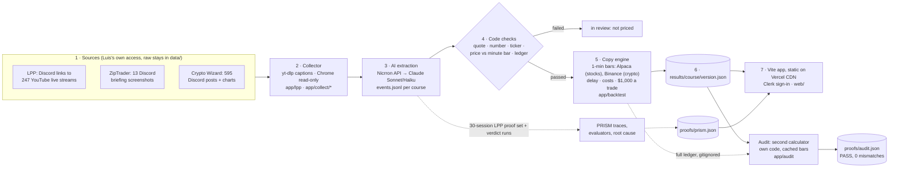

# Day Trader AI

**If you had copied every trade a paid trading course posted, would it have been worth it?**

We copy each course's posted trades with $10,000 of fake money, after trading costs, and compare that with just holding the market (SPY for stocks, Bitcoin for crypto).

- **Live app:** https://day-trader-ai.vercel.app (open in a private window to see onboarding)
- **Demo video:** [watch the demo](https://claude.ai/artifact/13kzNaaYG9PjSkgw8ZB5Qi) · **The problem in 5 slides:** [north star](https://claude.ai/artifact/Spjn9WB6PBtgEmGx4yv4CD)
- Built at MONEY TALKS 2 (AI × Finance hackathon, NYC, 2026-10-17), Money Intelligence track. Audited 2026-10-20 (`_bmad-output/planning-artifacts/spec-audit/`).

## The answer

<!-- numbers: update after stories 3,4,9 -->

Computed by today's copy engine at a flat $1,000 per trade (a compounding bankroll model, story 8, is coming), entering 5 minutes after each post, after costs. LPP uses no look-ahead (contracts.md rule 13, since story 18): he says he closes every day, so a position stays overnight only if he said he'd hold it before 15:55 ET. Source: `portfolios[id=all].by_delay["5"]` in each [`results/`](results/) file.

| Course | Window | Trades copied | $10k became | Just holding | Word | Held-out (sealed) last 3 months |
|---|---|---|---|---|---|---|
| Learn Plan Profit ([`lpp/v1`](results/lpp/v1.json)) | 2024-08-15 → 2025-09-12 | 342 | **$9,735.45** (−2.65%) | $11,963.79 SPY (+19.64%) | **No**: lost money, the S&P did better | **No**: made money (+2.08%) vs SPY +9.56% (103 trades) |
| Crypto Wizard ([`cryptowizard/v1`](results/cryptowizard/v1.json)) | 2025-10-17 → 2026-10-16 | 122 | **$9,290.30** (−7.10%) | $7,543.43 BTC (−24.57%) | **No**: lost money, less than Bitcoin | **No**: −0.08% vs BTC +26.04% (35 trades) |
| ZipTrader ([`ziptrader/v1`](results/ziptrader/v1.json)) | 2026-10-01 → 2026-10-16 | 1 | $10,007.02 (+0.07%) | $9,985.61 SPY (−0.14%) | **Not enough trades**: made money, about the same as the S&P | same window |

1. **Crypto Wizard lost money.** It lost 7.1%, less than Bitcoin's 24.6% drop, so it reads "No: lost money, less than Bitcoin" (it read "Yes" before story 4). In the held-out months it trailed Bitcoin by 26 points: No.
2. **The word** (`contracts.md` rule 9): under 30 trades = Not enough trades; lost money = No; else beat holding by 2+ points = Yes, within 2 = Barely, behind by 2+ = No. Each card says the outcome first, then the comparison, then the held-out months' word.
3. **Delay doesn't flip it.** LPP is "No" at every delay from 1 to 60 minutes (−7.69% to +3.26%; at 60 minutes it made money but trailed the S&P). Crypto Wizard is "No" (lost money, less than Bitcoin) at every delay (−6.46% to −7.62%).
4. **LPP v2** ([`lpp/v2`](results/lpp/v2.json)) re-extracts only the 30-session PRISM proof set: $10,966.20 vs v1's $10,884.58 on the same sessions (`same_sessions`), Barely. It is never compared with the full-year SPY return: its file's `compare_with` is v1 on the same sessions.
5. **The old reading, for comparison.** Each LPP file keeps `as_taught_stitched` (rule 11): positions stitched across sessions by his later words, all of a trade's buys together $1,000. LPP v1 there: $9,763.83 (−2.36%, 315 trades, No); v2 $10,300.52. Why it isn't the headline: [`notes/sources/lpp-discord-exits.md`](notes/sources/lpp-discord-exits.md).

Held-out (sealed) months: each course's last 3 months, kept apart so a later tweak can't be tuned on them.

The app reads only `results/` and `proofs/`. The delay slider and the 3m/6m/1y chips read the same files.

## Architecture



The model proposes; code decides. Every number in `results/` comes from the copy engine, checked by a second calculator. `proofs/prism.json` predates the audit fixes: its Knowledge Base `answer` is model-written text quoting older numbers ($9,765.86; 3,000 passed / 1,196 in review), and its `money_same_sessions` ($10,290.71 / $10,303.25) differ from `results/lpp/v2.json` ($10,287.41 / $10,300.52). Story 14 refreshes it.

## Tech stack

| Tool | What it does here | Where in code |
|---|---|---|
| yt-dlp | Downloads YouTube auto-captions of LPP's live streams | `app/lpp/fetch_captions.py` |
| Chrome (Luis's signed-in session) | Reads Discord read-only via its own search; never posts | method in `notes/sources/*.md` |
| Nicrron API (OpenAI-compatible) | Routes every model call | `app/lpp/extract.py`, `app/collect/*/common.py` |
| Claude Sonnet 5.5 / Haiku 5.5 | Reads captions, screenshots and charts into events with quotes. LPP: Claude Sonnet 5.5 via Nicrron (fallbacks: Claude Sonnet 5, then GPT-5.4, from `extract.py`), temperature 0 | same as above |
| Python checks | Reject events whose quote, number, ticker or price isn't in the source or the market | `app/lpp/checks.py`, `app/collect/ziptrader/checks.py`, `app/collect/cryptowizard/build_events.py` |
| Alpaca (paper keys) | Stock 1-minute bars (Yahoo 1-minute as fallback) | `app/backtest/bars.py` |
| Binance public klines | Crypto 1-minute bars, no key | `app/backtest/bars.py` |
| yfinance | Daily closes for just holding | `app/backtest/bars.py` |
| Copy engine (Python, pandas) | Prices every copied trade per delay, writes `results/` | `app/backtest/` |
| Second calculator | Recomputes every trade and headline without the engine's code | `app/audit/` |
| PRISM (prismtrace-sdk) | Traces the LPP proof set and verdict runs; Knowledge Base, Root Cause, evaluators | `app/prism/`, `app/lpp/prism.py` |
| Vite + vanilla JS | The web app; bakes `results/` and `proofs/` into a static build | `web/` |
| TradingView Lightweight Charts | Price and equity charts | `web/src/tradeChart.js` |
| Clerk | Google sign-in | `web/src/auth.js` |
| Vercel | Hosts the static build on its CDN | `web/deploy-vercel.sh` |
| FastAPI, SurrealDB | Read-only verdict API and course database (not used by the live app) | `app/api/`, `app/db/` |

## Where the data comes from

<!-- numbers: update after stories 3,4,9 -->

Counts from `cd app && uv run python -m audit.counts` (2026-10-20), explained in [`notes/sources/counts.md`](notes/sources/counts.md). 1. **Event:** one thing the course said: a trade leg (open, add, trim, close), a call (a level to watch) or a rule.
2. **In review:** an event that failed a code check; it is kept but never priced.
3. **Setup vs trade:** a setup is a posted plan (entry, stop, targets); it becomes a priced trade only once it has price bars and a fill.

| Course | Sources | Pulled how | Read by | Events | Passed every check | In review | Trades priced |
|---|---|---|---|---|---|---|---|
| Learn Plan Profit v1 | 247 live-stream links (246 with captions) | Discord links, then yt-dlp **YouTube auto-captions** | Claude Sonnet 5.5 via Nicrron (fallbacks: Sonnet 5, GPT-5.4), one call per session, temperature 0 | 4,196 | 2,883 | 1,313 | 342 |
| Learn Plan Profit v2 | same captions, new prompt | same | same | 4,128 | 3,773 | 355 | 51 (proof set only) |
| ZipTrader | 13 (12 briefings + 1 strategy card) | Discord screenshots | vision model, then a second model re-reads each briefing | 86 | 85 | 1 | 1 |
| Crypto Wizard | 595 posts (440 trade feed, 155 lessons; 42 skipped) | Discord search, read-only | code (regex) reads every number of the post template; Sonnet reads charts and lesson rules | 670 | 598 | 72 | 122 (126 setups; 4 had no price bars) |

1. **LPP is captions, not transcription.** YouTube's own auto-captions; nothing was transcribed by us. One stream (`41ixdD2nUp0`, 2024-09-18) has no captions.
2. **27 trading days have no LPP session:** 24 with no stream posted, 1 without captions, 2 where extraction found nothing (270 NYSE trading days in the window, 243 with events).
3. **ZipTrader's 86 events → 1 trade by design.** Its briefings are watch lists: 70 items name a ticker but no direction, so there's nothing to copy. Two weeks of briefings can't reach 30 trades anyway.
4. **Crypto Wizard** posts go back to 2021 (lessons); only setups inside the one-year window are priced.
5. **Copyright:** raw captions, posts and images stay in gitignored `data/` on Luis's Mac. The repo and app hold only counts, paraphrased rules and quotes of 12 words or fewer.

## How a trade is copied

Full rules: [`contracts.md`](_bmad-output/planning-artifacts/spec-day-trader-ai/contracts.md), "Copy-trade rules". In plain words:

1. **When he posts:** the Discord timestamp, or the stream's start plus the second he said it.
2. **When you get in:** the first 1-minute bar at post time + your delay (1, 3, 5, 10, 15, 30 or 60 min). If he gave a trigger price, only when price reaches it; otherwise no trade.
3. **When you get out**, first that applies: his own close or trim (+ delay); his stop or target (both in one bar = the stop); his stated horizon; else 15:55 ET for day trades, 24 hours for crypto. LPP holds overnight only when he said so before 15:55 ET that day (he says he closes every day). Every assumed exit is counted in the file's `unknown` list (LPP: 187 day trades, 3 swing).
4. **How much:** $1,000 for a trade's first buy; each add keeps his ratio to that first buy, from the share counts he had said by then. A trim with no size sells half. Unused cash earns nothing.
5. **Costs per side:** 5 bps stocks, 20 bps stocks under $10, 25 bps crypto.
6. **Just holding:** $10,000 in SPY or BTC at the window's first minute, sold at the last official daily close.
7. **Options** are counted, not priced (no free options price history).

## How we know it's right

<!-- numbers: update after stories 3,4,9 -->

**1. Counts reproduce.** `cd app && uv run python -m audit.counts` lists sources, events, passed, in review and priced trades per course from `data/` and `results/` (table above).

**2. Every event is checked by code before it's priced.** Its quote must appear in the source, its numbers in the quote, its ticker must resolve, a trade price must be within 1% of that minute's market bar, and the ledger must add up (no close without an open). Failures stay "in review" and are never priced.

**3. Extraction accuracy (LPP, provisional).** Against a 5-session gold set (126 events), from [`notes/sources/lpp.md`](notes/sources/lpp.md) §5:

| Version | Trade recall | Trade precision |
|---|---|---|
| v1 (all 247 sessions) | 96.4% (27/28) | 94.1% (32/34) |
| v2 | 96.4% (27/28) | 100% (27/27) |

The gold set was **drafted by an AI agent, not a human**, and v1 was tuned on those same 5 sessions. Treat these as provisional until story 5's human grading lands.

**4. A second calculator recomputes the money.** `app/audit/` is written from `contracts.md` alone, never imports the engine, reads the same cached bars, and rebuilds every position, trade and headline at every delay. Last run ([`proofs/audit.json`](proofs/audit.json)):

```
cd app && uv run python -m audit.run
cryptowizard/v1  PASS  trades checked  1736  mismatches 0  unverifiable 28
lpp/v1           PASS  trades checked  3605  mismatches 0
lpp/v2           PASS  trades checked  1071  mismatches 0
ziptrader/v1     PASS  trades checked    14  mismatches 0
PASS: every position, trade and headline reconciles
```

Tolerance: 1 cent per trade, $1 per headline. The 28 unverifiable rows are 4 Crypto Wizard setups × 7 delays with no price bars (skipped by both). It found 5 places the engine broke the contract; all were fixed in PR #58 ([`notes/audit/findings-story-2.md`](notes/audit/findings-story-2.md)).

**This PASS is code-to-code:** two programs agree on the same events and bars. It doesn't show the events are what the course said; Luis's hand-check sign-off and human grading are still open.

**5. Hand-check.** `cd app && uv run python -m audit.handcheck` writes 10 random trades with their raw bars for a person to verify; `uv run python -m audit.gate --sign Luis` records the sign-off.

**6. Observed in PRISM.** Only the 30-session LPP proof set and the verdict runs are traced (not every run; budget). From [`proofs/prism.json`](proofs/prism.json):

| Proof | Result |
|---|---|
| Root Cause | 25 failed `extract-lpp-v1` runs in one cluster: long caption quotes and lost track of open positions |
| Failed runs | 28 of 30 (v1) → 18 of 30 (v2) |
| "Numbers grounded", our code | 52% → 66% |
| "Numbers grounded", PRISM's judge | 50% → 47%: it saw cut-off output in 24 of 30 runs, so it can't separate versions |
| Verdict numbers come from results | v1 0% → v2 100% (our code checks) |
| Improver ("skip short-breakdown entries from 10:00 ET") | helped tuning months (−1.34% → +0.50%), not held-out (−0.09% → −0.09%): **not kept** |

Our 52%/66% and the 53.3%/66.7% in older notes use different denominators.

**Still unverified**

1. Human grading of extracted events (story 5): none yet, for any course.
2. Hand-check sign-off: `signoff` is `null` in `proofs/audit.json`.
3. Crypto Wizard and ZipTrader have no gold set at all.
4. 2 LPP sessions with captions produced zero events; not yet explained.

## Caveats

<!-- numbers: update after stories 3,4,9 -->

1. **Dividends left out.** SPY is price only; real holders got about 1% a year more, so just holding looks slightly worse than it was. That flatters the courses.
2. **Exposure vs fully invested.** At $1,000 a trade, LPP had at most $10,585 invested at any delay (above $10,000 only once gains had grown the cash; a buy that doesn't fit is sized down); Crypto Wizard $5,000. Just holding is 100% invested. A same-money benchmark (story 10) and a compounding bankroll (story 8) are coming.
3. **Look-ahead removed (LPP).** Since story 18 the headline decides each overnight hold only from what he had said before 15:55 ET (rule 13), as his own chat says he closes every day. His afternoon and after-hours trades off the stream aren't copied (story 24), and one channel where he posted closes is unreadable to Luis's account (story 23).
4. **Held-out months are before the model's training cutoff.** LPP's held-out months (from 2025-06-12) predate the extraction model's training cutoff, so AGENTS.md's "sealed after the cutoff" rule isn't met. The model only reads captions and prices come from code, but it isn't a clean out-of-sample test.
5. **The gold set is AI-drafted** (see above).
6. **27 LPP trading days are missing** (no stream, no captions, or no events).
7. **"1y" isn't the full window.** LPP's window is 13 months; the 1y chip ends 2025-08-14.
8. **Prices are 1-minute market bars**, not the host's own fills; costs are estimates.
9. **Worst drop** counts closed trades only.

## Run it

Keys go in `~/dev/quant-bot/.env` (see `app/README.md`); never commit it. Raw data lives in gitignored `data/`, so the collection and extraction steps only work on Luis's machine; the audit and the app work from the committed files plus cached bars.

```bash
cd app && uv sync

# counts per course (sources, events, passed, in review, priced)
uv run python -m audit.counts

# LPP: fetch captions, then extract and check events
uv run python -m lpp.fetch_captions --dry-run
uv run python -m lpp.run

# price the copied trades and write results/<course>/<version>.json
uv run python -m backtest.run --course lpp --version v1
uv run python -m backtest.run --course cryptowizard --version v1
uv run python -m backtest.run --course ziptrader --version v1

# second calculator: exits 0 only when everything reconciles
uv run python -m audit.run
uv run python -m audit.handcheck

# tests
uv run pytest -q
```

```bash
cd web && npm install && npm run dev
```

## Not financial advice

This is a research tool. It uses fake money and published trades, and says nothing about what anyone should buy. Course content belongs to its creators: the repo holds only derived rules and short citations.
