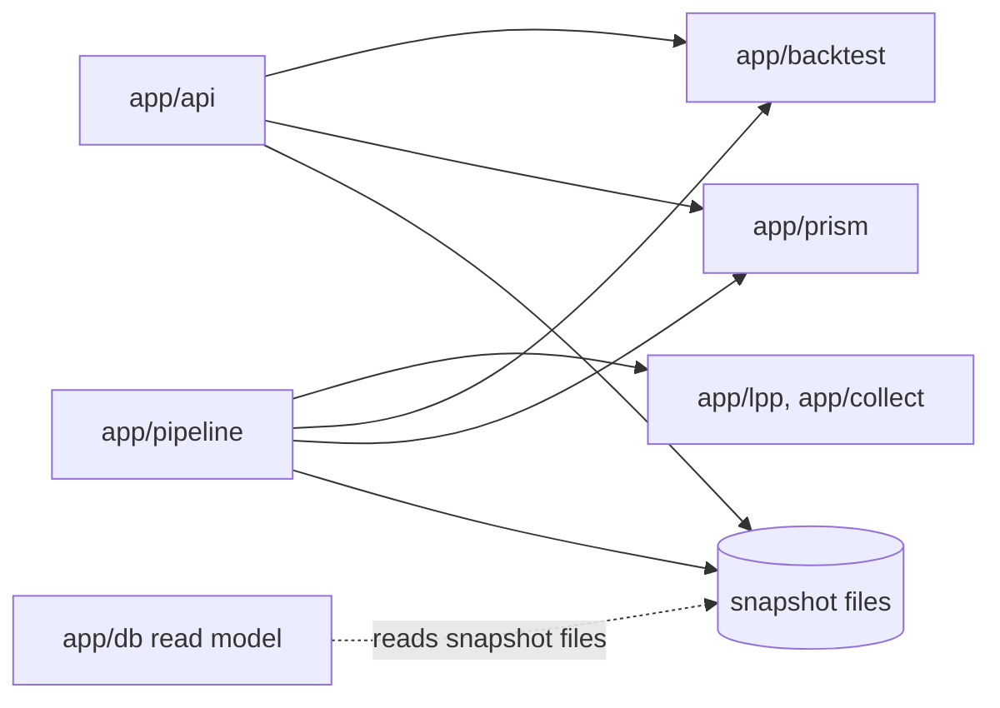
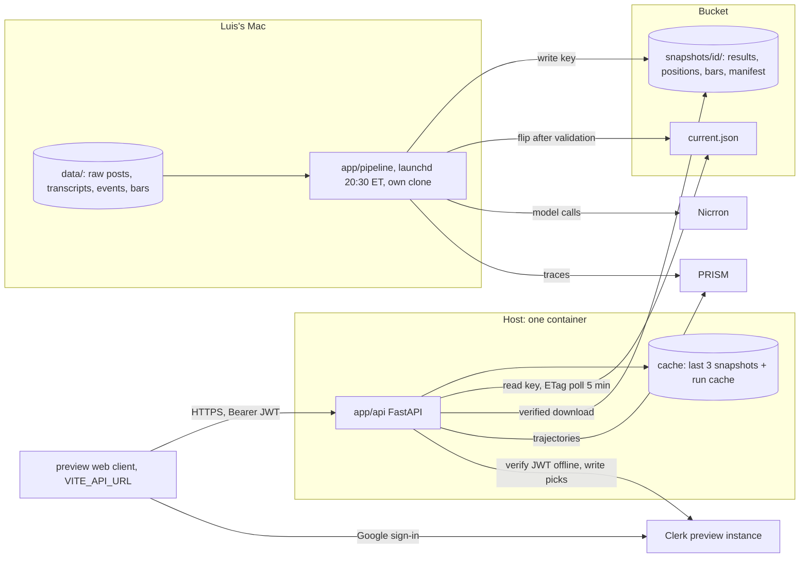

# Architecture Spine — Day Trader AI backend

Backend capabilities (B-ids), on top of the spec's CAP-1 to CAP-12:
B1 serve verdicts · B2 on-demand backtests (any delay 1–60, any range in the window) · B3 nightly refresh · B4 Google sign-in and per-user course picks · B5 a PRISM trace per API-triggered run · B6 cost, caching, rate limits · B7 hosting.

## Design Paradigm

**Snapshot serving.** Offline pipelines on Luis's Mac (pipes and filters: collect → extract → check → build positions → backtest → snapshot → validate → publish) write **immutable, content-addressed snapshots**. One **stateless API** binds the current snapshot and runs the **same pure engine** on demand behind a **content-addressed run cache**. Only pipelines write data; the API reads and computes.

| Layer | Directory | Owns |
| --- | --- | --- |
| Collect and extract | `app/lpp/` (PR #18), `app/collect/*` | `data/<course>/` on Luis's Mac |
| Engine (pure core) | `app/backtest/` | Copy-trade rules, the word, portfolio math, `compute`, `ids.py`, `positions.py` |
| Pipeline (new) | `app/pipeline/` | Nightly run, snapshot build, validate, publish, `windows.json`, `headline.json` |
| API (new) | `app/api/` | HTTP, auth, the bound snapshot, run cache, limits, trace queue |
| Tracing | `app/prism/` | PRISM client and trajectory shape |
| Read model (optional) | `app/db/` (PR #11, merged) | SurrealDB on Surreal Cloud, rebuilt by its loader |



Arrows are the only allowed imports. `app/backtest` imports nothing from `api`, `pipeline`, `prism` or `db`. `app/api` never imports `app/lpp`, `app/collect` or `app/db`, and never calls a course module's `build`, `load`, `proof_set` or `unknown`.

## Inherited Invariants

| Inherited | From | Binds here |
| --- | --- | --- |
| Contracts 1–7 (results/1, copy-trade rules, proofs, agent_ids, traces, who writes where, v2 keys) | `AGENTS.md`, `contracts.md` | Snapshot results files are results/1 unchanged; every amendment below goes to `AGENTS.md` by PR first (backend-0) |
| Rule 3: the model proposes, the code decides | `AGENTS.md` | Every number and every word the API returns comes from the engine or a snapshot file; clients never compute a word or a range |
| Rule 4: sealed holdout, every version logged | `AGENTS.md` | AD-17 |
| Rule 5: raw course content only in gitignored `data/` | `AGENTS.md` | Snapshots, the server, PRISM and logs carry derived records only (quotes ≤ 12 words) |
| No video IDs or YouTube links outside `data/` | PRs #43–#45 (`backtest.common.public_json`, `prism.common.scrub`) | Every snapshot file, API response and PRISM payload; the API skips any file that holds one |
| Rule 6: Discord read-only, light, supervised | `AGENTS.md` | No unattended Discord reads, LPP's session links included; no Discord access from the server |
| Rule 7: fake money only | `AGENTS.md` | No brokerage, no real orders, no personal financial data |
| Decision 3: everyone sees the same verdicts | `AGENTS.md` | Verdicts are public reads; per-user state is picks only (AD-8 amends "no per-user data on a server" only if Luis picks Clerk) |
| The live demo is frozen | Luis, 2026-10-17 | AD-12 |

## Invariants & Rules

### AD-1 — A snapshot is the unit of truth; it is immutable and content-addressed

- **Binds:** all; B1, B2, B3
- **Prevents:** the API, a database and the pipeline each holding a different "current" verdict; the server pricing different inputs from the ones the night priced.
- **Rule:** A snapshot folder `snapshots/<snapshot_id>/` holds `results/<course>/v<n>.json` (results/1, unchanged), `positions/<course>/v<n>.jsonl` (AD-14), `bars/` (AD-5) and `manifest.json` (`snapshot_id`, `created_at`, `engine_version`, `git_sha`, `headline` per course, `windows`, sha256 per file). `snapshot_id` is computed only by `app/backtest/ids.py` (until backend-3 moves it there, `app/api/snapshot.py` holds the same code): first 12 hex of sha256, UTF-8, over the sorted lines `<path>:<sha256 of bytes>` joined by `\n` with no trailing newline, for every `.json` and `.jsonl` file, dotfiles excluded, under `results/`, `positions/` and `bars/`, paths POSIX and relative to the snapshot folder. The manifest is not hashed. Only `app/pipeline` writes snapshots; nothing edits one after publish. A snapshot goes live only by replacing `current.json` (`{"snapshot_id": …}`) after validation.

### AD-2 — Databases are derived read models

- **Binds:** B1, B2, CAP-2; `app/db`
- **Prevents:** a database becoming a second writer, and a database outage breaking verdicts or runs.
- **Rule:** Any database (SurrealDB from PR #11, or another) is rebuilt from files by its loader (today `app/db/load.py` from `data/` on Luis's Mac; later from a snapshot) and may be dropped at any time. The verdict and run paths never read a database. A database may serve only queries files can't answer cheaply (rule search, day lookup across courses), behind its own endpoint, and once it loads from snapshots, every row it returns carries the `snapshot_id` it was loaded from.

### AD-3 — One pure engine; the headline is declared, not inferred

- **Binds:** B1, B2, B3, CAP-1, CAP-5, CAP-6
- **Prevents:** API numbers drifting from nightly numbers; the nightly flipping a public verdict by accident; the container failing to import the engine.
- **Rule:** `backtest.compute(positions, window, hold_series, delays, start, end) -> (result, steps)` is the one pricing function; the CLI, the pipeline and the API all call it and add nothing to the math. It is pure: it reads only its arguments and the bars root it is given, writes nothing, starts no subprocess, reads no `.env` (`git_sha()`, `_main_checkout()` and `load_dotenv` run only inside the CLI's `main()`). The word comes only from `engine.word`. `engine_version` is `ids.engine_version()`: first 12 hex of sha256 over the sorted `<path>:<sha256>` lines of `app/backtest/*.py` (tests excluded). Each course's headline version is declared in `app/pipeline/headline.json`, changed only by Luis's PR, copied into `manifest.headline`; the API reads only that. For a folder without a manifest (story 1's `results/`), the API applies the web's `latest()` rule: highest version not marked `same_sessions.proof_set`, else the highest. Versions compare as `int(v[1:])`.

### AD-4 — On-demand runs are normalized and content-addressed

- **Binds:** B2, B5, B6, CAP-1, CAP-11
- **Prevents:** stale cached runs; two units hashing the same request differently; two meanings of "range".
- **Rule:** A run request is a `RunSpec` {`course`, `version`, `portfolio`, `delay_min` int 1–60, `start`, `end`}. The API fills every default from the bound snapshot first (`version` = headline, `portfolio` = `all`, `start`/`end` = the window), then validates (`start` ≤ `end`, both inside the window). `run_key` = `ids.run_key(spec, snapshot_id, engine_version)` = sha256 hex of `json.dumps(spec, sort_keys=True, separators=(",", ":"))` + `\n` + `snapshot_id` + `\n` + `engine_version`. A spec equal to a precomputed one (whole window, a delay in `delays_min`) is answered from the snapshot file with no compute. A range keeps trades whose first entry is on or after `start` and whose last exit is on or before `end`; just holding is rebased on the results file's `series.hold`; `sealed` is null when `end` < `sealed_from`. Only completed results are cached; a timeout or error never is. The cache evicts least-recently-used entries past `RUN_CACHE_MB` (default 500), entries of non-live snapshots first; an evicted key recomputes to the same result.

### AD-5 — The request path never touches the network for data

- **Binds:** B2, B6, B7
- **Prevents:** feed drift between nightly and on-demand numbers; key burn on public traffic; unbounded latency; a server writing bars.
- **Rule:** A snapshot's `bars/` mirrors the subset of `data/bars/` its positions touch, byte for byte, same paths. On the server `BARS_OFFLINE=1`: every bar fetch raises `NoBars("offline")` before any network call and writes nothing. A missing session prices as `no_bars` and is counted in `unknown`. Just holding comes from the results file's `series.hold`, never `daily_closes`. Only the pipeline on Luis's Mac fetches bars from Alpaca, Binance or Yahoo.

### AD-6 — Runs are synchronous and bounded

- **Binds:** B2, B6, B7
- **Prevents:** a slow or abusive caller starving the server.
- **Rule:** A cache-miss run executes in-process in a worker pool of 2. When both workers are busy the API answers 429 `runs_busy` with `Retry-After`. A run past 10 s answers 504 `run_timeout` (traced as an error, never cached); its worker slot frees when the run ends, since threads can't be killed. No job queue until a measured run passes 5 s (today 0.3–0.6 s with warm bars).

### AD-7 — Sign-in is Clerk; the API keeps no identity

- **Binds:** B4, CAP-3, CAP-4
- **Prevents:** two auth schemes; machine tokens passing as users; personal data on our server.
- **Rule:** The token travels as `Authorization: Bearer <session JWT>`. The API verifies it networklessly with `clerk-backend-api` `authenticate_request(jwt_key=<PEM>, authorized_parties=ALLOWED_ORIGINS, accepts_token=["session_token"])` and itself rejects `sts=pending`. `ALLOWED_ORIGINS` is one list of stable URLs (no per-commit preview URLs) read by both CORS and `authorized_parties`. Public, no token: `/health`, verdict and results reads. Token required: `POST /v1/runs`, `/v1/me/*`. The only user value the API keeps, logs or sends is `auth.user_hash(id)` = first 16 hex of HMAC-SHA256(`USER_HASH_SALT`, Clerk user id). The preview uses its own Clerk development instance, never the one the live demo uses.

### AD-8 — Picks: one write path, one read path

- **Binds:** B4, CAP-4
- **Prevents:** stale or conflicting picks between onboarding and the verdict tabs.
- **Rule:** [ASSUMPTION, open question 2] `PUT /v1/me/picks` takes `{"picks": [...]}`: 0–3 unique course ids from the bound snapshot, order kept; it writes Clerk `publicMetadata.course_picks` and returns 200 `{"picks", "snapshot_id"}`. `GET /v1/me/picks` returns the session token's `picks` claim intersected with the snapshot's courses. After a `PUT` the client uses the response and refreshes its token (`getToken({ skipCache: true })`) before its next call. The client never writes or reads `publicMetadata` itself. If Luis keeps browser storage instead, these routes don't exist and picks never reach the API.

### AD-9 — Every API-triggered run is traced, off the request path

- **Binds:** B5, B6; contracts 4 and 5
- **Prevents:** PRISM latency failing requests; traces leaking text or identity; API or nightly traces moving the frozen demo's PRISM numbers.
- **Rule:** Each computed (cache-miss) run enqueues exactly one trajectory: `agent_id` `daytrader-api-backtest-v1`; `conversation_id` `api-<course>-<run_key[:12]>`; the `tool_call` steps are the `steps` `compute` returned (`load_snapshot`, `load_positions`, `simulate`, `portfolio_stats`, each with `tool_name`, a locator `input`, a counts `output`, `status`, `ms`); `app/api/trace.py` only appends one `final_answer` (the headline numbers) and metadata, and never re-runs a step. `final_status="error"` names the failed check. Metadata is exactly `{agent_version: "v1", course, prompt_version: null, git_sha, proof_set: false, snapshot_id, engine_version, run_key, user}`. The queue holds 100, drops oldest on overflow and logs each drop; PRISM down never fails a request. Cache hits and precomputed answers are not runs and are not traced. Nightly extraction traces under `extract-<course>-nightly-v<n>`, never under a proof agent_id (`extract-lpp-v1/v2`, `daytrader-verdict-v1/v2`). backend-0 adds both ids to contract 4 and amends contract 5's scope to: the proof set, verdict runs, API runs, nightly extraction.

### AD-10 — No model call on the request path; pipeline calls are cacheable

- **Binds:** B2, B3, B6
- **Prevents:** per-click model spend; nightly re-runs paying twice for one source.
- **Rule:** The API never calls a model; text for any run is templated by code from its numbers. Pipeline model calls go through Nicrron at `temperature: 0` with a versioned `prompt_version`. The guaranteed line is our ledger: a source is extracted once per (`source_id`, `model`, `prompt_version`). Nicrron's free exact cache (`X-Nicrron-Cache: HIT`) is a second line for non-streamed calls; whether streamed calls hit it is unconfirmed and checked in backend-7. Long calls stream.

### AD-11 — The pipeline runs on Luis's Mac, from its own clone, and publishes derived data only

- **Binds:** B3; rules 5 and 6
- **Prevents:** raw content on a server; unattended Discord reads; a half-built night going live; the CLI dirtying the frozen demo's files.
- **Rule:** A launchd job runs `app/pipeline` at 20:30 ET from its own clone `~/dev/quant-bot-nightly` (never the main checkout or a worktree), writing only under `$SNAPSHOT_BUILD_DIR`; it imports `backtest.compute` and never shells out to `backtest.run`. Stages: collect only sources a supervised read already queued (LPP's session links come from Discord, so they follow open question 4), extract, code-check, build positions, price every delay over the window, build the snapshot, validate (results/1 schema; every delay present; quotes ≤ 12 words; `public_json`'s private-ID check on every file; positions re-priced at the default delay equal the results file), publish files then bars, flip `current.json`. A night whose inputs (positions, bars, `engine_version`) hash the same as the live snapshot's publishes nothing. Any failed stage stops the night, keeps the live snapshot, and posts a macOS notification to Luis. A night missed while the Mac sleeps runs on wake.

### AD-12 — The live demo is frozen

- **Binds:** all; `web/`, `results/`, `proofs/` on main
- **Prevents:** backend work changing what judges see at https://day-trader-ai.vercel.app or behind its PRISM links.
- **Rule:** No backend story deploys to production, changes that URL, or changes how main's `web/` behaves; no script passes `vercel --prod`. git `results/` and `proofs/` stay the hackathon snapshot; the pipeline never writes them. A web client that calls the API sits behind `VITE_API_URL`, ships to preview deploys only, and may merge only when a build without `VITE_API_URL` behaves exactly like main (story 5's flow test passes).

### AD-13 — Limits and budgets are in one module

- **Binds:** B6, B7
- **Prevents:** runaway compute or PRISM credits; two counters for one cap.
- **Rule:** All counters live in `app/api/limits.py`. Token buckets: public reads 60/min per IP (the first `X-Forwarded-For` hop the host sets; uvicorn runs with `FORWARDED_ALLOW_IPS` for the host's proxy), runs 10/min, burst 5, per user hash. `RUNS_PER_DAY` (UTC day, default 20 until the post-hackathon PRISM plan is known) counts cache-miss computations only, consumed just before compute; it is the only cap on API traces. 429 codes are exactly `rate_limited`, `runs_busy` and `daily_cap`, each with `Retry-After` in seconds. Pipeline: Nicrron client bucket 50 requests/min with backoff on 429 and 502; `NIGHTLY_BUDGET_USD` stops extraction past the night's estimated spend. One API instance only (Deferred).

### AD-14 — The engine's input is published, not rebuilt

- **Binds:** B2, B3; `app/backtest/positions.py`
- **Prevents:** the server building different positions than the night priced (course-specific files, the proof set, session keys).
- **Rule:** The pipeline runs each course module's `build`, de-duplicates `pid`s (the loop now in `backtest.run.main`, moved to `positions.build_positions(course, version)`), and writes them with `positions.dump` to `positions/<course>/v<n>.jsonl`: one `Position` per line, `Position` and `Leg` fields only, `quote` ≤ 12 words, session keys in place of video IDs. That field list is the validator's allowlist. The API loads positions only with `positions.load`. A run's `rules`, `unknown` and `checks` are copied from the snapshot's results file for that course and version.

### AD-15 — A request binds one snapshot

- **Binds:** B1, B2, B5
- **Prevents:** a swap mid-run mixing two snapshots and caching the mix forever.
- **Rule:** `app/api/snapshot.py` alone holds the live reference. Each request takes it once at entry (an immutable `Snapshot`: id, manifest, folder) and uses it for every read, the run key, the response and the trace. A swap downloads every manifest file into `cache/snapshots/<id>/`, checks each sha256 and recomputes `snapshot_id`, and only then replaces the reference in one assignment; any mismatch keeps the old one. The server keeps the live snapshot and the two before it; the bucket keeps the last 10. The API polls `current.json`'s ETag every 5 minutes and on boot.

### AD-16 — The window is snapshot data; the holdout doesn't slide

- **Binds:** B2, B3, CAP-9, CAP-11, CAP-12; rule 4
- **Prevents:** the server and the night using different windows; formerly sealed months becoming dev months.
- **Rule:** `compute` takes `window` from the results file being priced or extended; `mod.WINDOW` is only the CLI default. Each course's `sealed_from` is fixed in `app/pipeline/windows.json` and moves only by an `AGENTS.md` PR; the nightly may extend `end` only. Dev-month picks (`combos`, `suggestion`) use only dates before `sealed_from`.

## Consistency Conventions

| Concern | Convention |
| --- | --- |
| Paths | REST + JSON under `/v1`; `GET`/`HEAD /health` unversioned. `/v1/courses`, `/v1/courses/{course}/verdict?delay_min=`, `/v1/courses/{course}/results/{version}`, `POST /v1/runs`, `GET /v1/runs/{run_key}`, `/v1/me/picks` |
| Responses | `/verdict` and `/v1/runs*` both return `verdict/1`: `{schema: "verdict/1", snapshot_id, engine_version, course, course_name, version, portfolio: {id, label}, delay_min, start, end, source: "snapshot" or "run", run_key (null for snapshot), at: <the results/1 by_delay entry verbatim>, series: {dates, hold, money}, window, hold, rules, unknown}`. A run is never labelled results/1. `/results/{version}` returns the file's bytes unchanged |
| Ids | `course` ∈ `lpp`, `ziptrader`, `cryptowizard`; `version` `v<n>`, n ≥ 1, no leading zero; `delay_min` integer minutes in every query and body; `snapshot_id`, `engine_version` 12 hex; `run_key` 64 hex |
| Times | Session dates `YYYY-MM-DD` (ET for stocks, UTC for crypto, as the engine does); timestamps UTC ISO with `Z` |
| Numbers | Copied from the snapshot or the engine, never rounded again; money in USD floats; percents as `ret_pct` points; no NaN or Infinity (a file holding one is skipped) |
| Errors | `{"error": {"code": "<snake_case>", "message": "<plain words>"}}` for every 4xx and 5xx, validation and 405 (with `Allow`) included |
| Snapshot id | `X-Snapshot-Id` header on every response; also in the body of our own JSON shapes |
| Broken files | Skipped and listed in `/health.skipped`; a course with any skipped file is withheld whole; `/health` answers 503 with `ok: false` when no course is served |
| Config and secrets | Env vars, read once at startup in `app/api`. Server holds only `CLERK_JWT_KEY`, `CLERK_SECRET_KEY` (picks writes), `PRISMTRACE_API_KEY`, `PRISMTRACE_PROJECT_ID`, `USER_HASH_SALT`, the bucket read key, `ALLOWED_ORIGINS`; it refuses to start if a Nicrron or Alpaca key is set. The Mac holds the bucket write key. Secrets are never logged, traced or returned |
| Logging | One JSON line per request (method, path, query, status, ms, `snapshot_id`, `run_key` when any, `user` hash when any); uvicorn runs with `--no-access-log`; an unhandled error becomes the 500 envelope with its traceback inside the line |
| Tests | pytest under `app/<package>/tests/`; API tests build fixture snapshot folders and never touch the network |
| Build | Container runs `uv sync --frozen` from `app/uv.lock`; `prismtrace-sdk` pinned exactly |

## Stack

| Name | Version |
| --- | --- |
| Python | 3.13 (existing `app/`) |
| FastAPI | 0.143.3 |
| Starlette | 1.8.0 (with FastAPI) |
| Uvicorn | 0.54.0 |
| httpx2 (TestClient's client, via openai) | 2.13.1 |
| httpx (fallback, and `bars.py` at runtime) | 0.28.1, < 1 |
| pytest | 9.1.1 |
| clerk-backend-api | 7.0.0 (backend-4) |
| prismtrace-sdk | 0.5.3, pinned exactly |
| openai (Nicrron client) | ≥ 3.33.0 (existing) |
| surrealdb (only if the read model stays) | 2.0.0 (3.0 is beta) |
| Host | Railway Hobby, one service [ASSUMPTION: recommended, open question 1] |
| Snapshot bucket | Cloudflare R2 (10 GB free; card on file) [ASSUMPTION, follows open question 1] |

## Structural Seed



```text
app/
  api/            # main.py (routes, envelope, logging), snapshot.py (bound snapshot, swap), runs.py, auth.py, limits.py, trace.py
    tests/
  pipeline/       # nightly.py (stages), build.py (snapshot + manifest), validate.py, publish.py, windows.json, headline.json
    tests/
  backtest/       # engine (existing) + compute(), ids.py (snapshot_id, engine_version, run_key), positions.py (build, dump, load)
```

Environments: **local** (Mac; `SNAPSHOT_DIR` = a folder; no bucket), **preview** (host preview service + a Vercel preview alias for the web client + a Clerk development instance of its own), **production** (later, Luis's call; not in these stories).

Operations: **rollback** a snapshot by pointing `current.json` at an earlier id (Luis, or the pipeline's `publish --rollback`); **rollback** code by redeploying the previous image on the host. **Health:** `/health` reports `snapshot_id`, the manifest's `created_at` and age (`stale` past 36 h), skipped files, trace-queue drops and run-cache size. **Alerts:** the night's failure notifies Luis on his Mac; the host's uptime check probes `HEAD /health`.

## Capability → Architecture Map

| Capability / Area | Lives in | Governed by |
| --- | --- | --- |
| B1 verdicts, CAP-5, CAP-6, CAP-10, CAP-11 | `app/api` over the bound snapshot | AD-1, AD-3, AD-15, conventions |
| B2 on-demand runs, CAP-1 (any delay), ranges | `app/api` runs + `backtest.compute` | AD-3, AD-4, AD-5, AD-6, AD-14, AD-16 |
| B3 nightly refresh | `app/pipeline` on Luis's Mac | AD-1, AD-10, AD-11, AD-14, AD-16 |
| B4 sign-in, picks, CAP-3, CAP-4 | `app/api` auth + Clerk | AD-7, AD-8 |
| B5 PRISM tracing | `app/api/trace.py` + `app/prism` | AD-9, AD-13 |
| B6 cost, caching, limits | `app/api/limits.py`, run cache, pipeline ledger | AD-4, AD-10, AD-13 |
| B7 hosting and operations | one container + bucket | AD-5, AD-6, AD-15, Structural Seed |
| CAP-2 day lookup | snapshot `days`, or the read model | AD-2 |
| CAP-7 per-trade chart | snapshot `trades`; a minute-bars endpoint is deferred | AD-5, Deferred |
| CAP-8 the proof | `proofs/prism.json` (frozen) | AD-9, AD-12 |
| CAP-9, CAP-12 improver, best mix | pipeline only (dev months) | AD-10, AD-16 |

## Deferred

- **More than one API instance:** needs a shared limiter and run cache. Revisit when one machine is busy.
- **A job queue and progress for runs:** only when a measured run passes 5 s (AD-6).
- **A minute-bars endpoint for CAP-7:** after Alpaca's and Binance's market-data terms are checked for showing bars to the public.
- **Production launch** (domain, Clerk production instance, uptime alerts to a phone): Luis's call after the preview works.
- **Serving verdict-agent text:** the verdict agent stays a pipeline job (`daytrader-verdict-vN`); until a story serves its text, every response's text is code-templated (AD-10).
- **Typed response models and an OpenAPI contract file:** with backend-3, when `verdict/1` has two producers.
- **Per-user portfolios, saved runs, payments; pricing options:** spec non-goals.

## Open Questions

1. **Hosting:** Railway Hobby (recommended: always-on, no cold start, hard spend limit, ≈ $6–8/mo), Fly.io (≈ $4/mo; rough month of incidents), or Render (≈ $7.75/mo; 0.5 CPU). Blocks backend-2.
2. **Picks:** browser storage (today; no backend), Clerk `publicMetadata` (AD-8; amends Decision 3), or a table of ours. Blocks backend-4.
3. **Database role:** keep SurrealDB (merged in PR #11) as a read model (AD-2; it is hosted, which amends the spec's "no cloud database" non-goal), drop it, or make it the store.
4. **Discord at night:** supervised (Luis OKs a queue each morning), weekly by hand, or bounded automatic (changes rule 6). Covers LPP's session links too. Blocks backend-7.
5. **Nicrron after 2026-10-18 18:00 ET:** the hackathon credits expire; keep Nicrron on paid credits with `NIGHTLY_BUDGET_USD`?
6. **PRISM after the hackathon:** which plan and credits; sets `RUNS_PER_DAY`.
7. **Backups of `data/`:** the one store that can't be rebuilt (raw content, the session-key map, the ledger, the gold set). Where does a second copy live?
</content>
</invoke>
